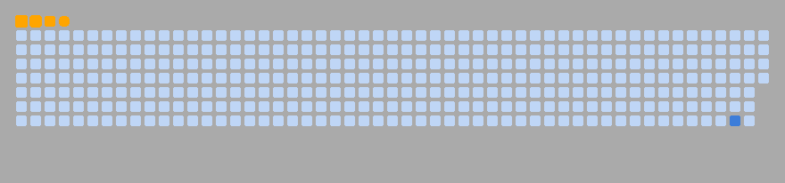

## Hi there 👋
<h1 align="center">Hi, I'm Fei Fei 👋</h1>

<h3 align="center">Technology · Engineering · AI · Automation</h3>

  

---

## ⚡ About Me

- 🔭 Exploring engineering simulation and intelligent automation
- 🤖 Interested in AI applications and technology
- 💻 Working with Python, MATLAB, C/C++ and engineering tools
- 🚀 Building, learning and experimenting

## 🛠 Tech Stack

  

## 📊 GitHub Statistics

  
  

## 🧊 3D Contribution

  

## 🐍 Contribution Snake

  <picture>
    <source media="(prefers-color-scheme: dark)" srcset="dist/github-snake-dark.svg">
    <source media="(prefers-color-scheme: light)" srcset="dist/github-snake.svg">
    
  </picture>

  

---

<i>BUILD · CREATE · EXPLORE · REPEAT</i>

<!--
**feifeimao7/feifeimao7** is a ✨ _special_ ✨ repository because its `README.md` (this file) appears on your GitHub profile.

Here are some ideas to get you started:

- 🔭 I’m currently working on ...
- 🌱 I’m currently learning ...
- 👯 I’m looking to collaborate on ...
- 🤔 I’m looking for help with ...
- 💬 Ask me about ...
- 📫 How to reach me: ...
- 😄 Pronouns: ...
- ⚡ Fun fact: ...
-->
